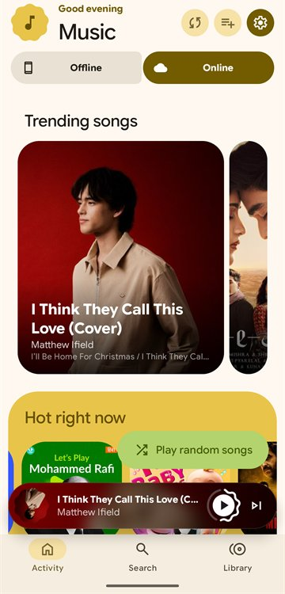
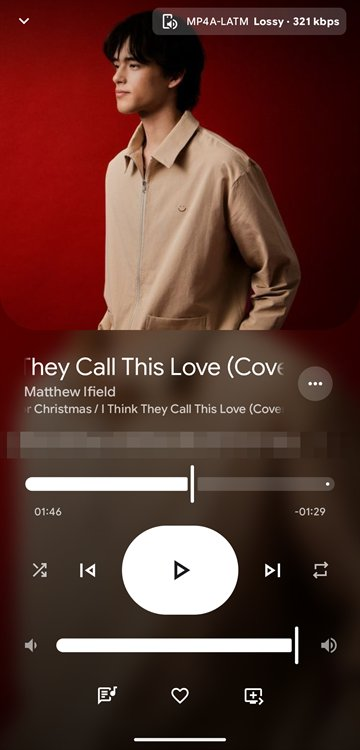
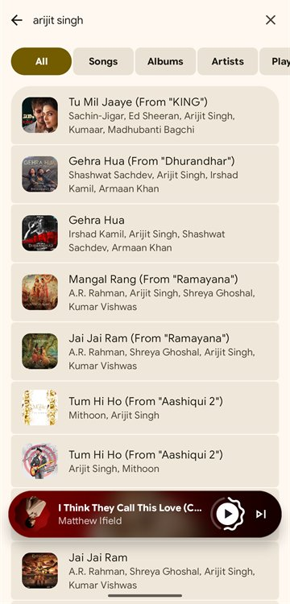
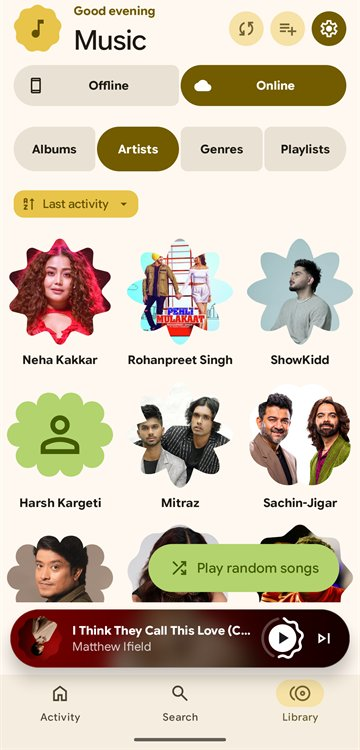
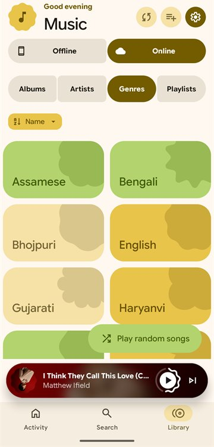

<!--
     SPDX-FileCopyrightText: The LineageOS Project
     SPDX-License-Identifier: Apache-2.0
-->

# Twelve (online edition)

A music player for Android, built on [LineageOS Twelve](https://github.com/LineageOS/android_packages_apps_Twelve).
It keeps everything Twelve does with local files and media servers, and adds an online catalog, a
redesigned player and a Material 3 Expressive look.

**[Download the latest version](https://github.com/yusufnoor786/packages_apps_Twelve/releases/latest)**
(Android 11 or newer)

## Screenshots

<table>
  <tr>
    <td align="center"><br>Home</td>
    <td align="center"><br>Player</td>
    <td align="center"><br>Search</td>
  </tr>
  <tr>
    <td align="center"><br>Artists</td>
    <td align="center"><br>Genres</td>
    <td></td>
  </tr>
</table>

The colors follow the wallpaper of the phone (Material You).

## What's new in this edition

**Online and offline**
- One switch on the home screen: **Offline** shows only the music stored on the device (empty when
  there is none), **Online** shows songs, albums, artists and playlists from the JioSaavn catalog.
- Separate streaming quality limits for Wi-Fi and mobile data, with the quality of the current
  stream shown next to its format.
- The online home page is cached, so it opens instantly and still shows what was seen without a
  connection. Pull down to refresh it.

**Player**
- The player sits on top of the app: it opens and closes without rebuilding the screen below.
  Swipe it down to make it the mini player, swipe up on the cover for the queue.
- Lyrics synchronized word by word when available, line by line otherwise, shown in place over a
  blurred cover. The controls hide while you read and come back when you tap or pause. A lyrics
  offset can be set when a song's timings are off.
- Volume slider, AutoPlay (similar songs keep coming when the queue ends), crossfade from 0 to 12
  seconds (0 is gapless), and **Automix (beta)**, which starts the next song on a beat at the tempo
  of the one that is ending.
- The mini player sits on the blurred cover of the song, so it stays readable on any screen.

**Playlists**
- Import playlists from Spotify links (public playlists, no account needed), CSV files or plain song
  lists. The songs are matched in the online catalog.
- Share, save and import playlists of the online catalog. Delete playlists from their menu.

**Look and feel (Material 3 Expressive)**
- Material shapes for artist pictures, genre tiles and the app's own mark, with a shape change
  on press.
- Connected button groups for the Offline/Online switch, the Library tabs and the search filters.
- Grouped lists with round outer corners in every list and in Settings.
- A hero carousel on the home screen, and a play button whose shape follows the playback state.
- Album and playlist pages keep Play all, Shuffle, Play next and Add to queue in their header.

**Search**
- A start screen, filters (All, Songs, Albums, Artists, Playlists) and a clear "no results" screen.
- Tapping a song plays it. When something is already playing, a menu asks whether to play it now,
  play it next or add it to the queue.

**Widgets**
- Now playing widgets that fill with the cover and adapt their layout to their size, from 1x1 to
  4x4, including dedicated 1x1, 2x1, 2x2 and 2x4 widgets.

**Speed**
- Pages stay alive under the page on top of them, so going back is instant.
- Lighter list rows and shaped pictures drawn once instead of on every frame.

## Building

### With the ROM

Put this repository at `packages/apps/Twelve` in the source tree, add `Twelve` to
`PRODUCT_PACKAGES` of the device or product, and build as usual. `app/Android.bp` lists the
libraries; the ones that are not part of the platform are in `app/libs`. Nothing else has to be
added.

### With Gradle (Android Studio)

```
./gradlew assembleDebug
```

The debug build installs as `org.lineageos.twelve.dev`, next to a Twelve that comes with the ROM.

### Updating the Twelve of a ROM with an APK

A release APK signed with the key of the ROM installs over the Twelve that comes with it, like any
app update: no new ROM build, no root, and the music library, playlists and settings stay.

1. Make a PKCS12 keystore of the key the ROM signs its apps with. For a ROM built with the default
   test keys these are `build/make/target/product/security/testkey.pk8` and `testkey.x509.pem`:
   ```
   openssl pkcs8 -inform DER -nocrypt -in testkey.pk8 -out testkey.key.pem
   openssl pkcs12 -export -in testkey.x509.pem -inkey testkey.key.pem -name testkey -out testkey.p12
   ```
   Keep it outside this repository and delete `testkey.key.pem`.
2. Tell Gradle where it is in `local.properties` (never committed):
   ```
   twelve.rom.storeFile=/path/to/testkey.p12
   twelve.rom.storePassword=...
   twelve.rom.keyAlias=testkey
   twelve.rom.keyPassword=...
   ```
3. Build with `./gradlew assembleRelease`. `app/build/outputs/apk/release/app-release.apk` installs
   on any phone running the ROM.

The version code must never be lower than the one of the ROM (`app/Android.bp`). Without these
settings the release APK is not signed and cannot be installed. A factory reset, or "Uninstall
updates" in the app info, goes back to the version of the ROM.

### Publishing an update

The app looks for a newer version in the GitHub releases of the repository set in
`app/src/main/res/values/config_update.xml` (`owner/name`, empty to build without updates):
when it opens, from **Settings → Updates → Check for updates**, and about once a day in the
background. A newer version shows a notification and a popup with the release notes, to download
and install it or put it off for a day. Android asks the user to confirm the install, and the
first time to allow the app to install updates.

1. Raise `versionCode` and `versionName` in `app/build.gradle.kts`, and the same values in
   `app/Android.bp`.
2. Build the signed release APK (see above) and name it `Twelve-<versionName>-<versionCode>.apk`,
   for example `Twelve-2.1-3.apk`: the app reads the version from that name.
3. Create a GitHub release, for example with the tag `v2.1`, attach the APK, and write the notes:
   they are shown in the popup (Markdown lists, bold and links are shown as plain text).

The app installs an APK only when its SHA-256 matches the one GitHub gives for the file. Drafts and
pre-releases are not offered.

## Accounts

Signing in keeps the favorites, the playlists and some settings of the online catalog (languages,
streaming quality, AutoPlay, crossfade, Automix, lyrics offset) with the account, the same on every
phone signed in to it. Signing in shows the library of the account; signing out or deleting the
account removes it from the phone. Without an account everything stays on the phone, as before.
Local files, and the playlists of media servers, stay where they are.

Accounts live in a [Supabase](https://supabase.com/) project, set in
`app/src/main/res/values/config_account.xml`: the project URL and its publishable key, which is
meant to be in apps. Leave both empty to build without accounts. Once, in the dashboard of the
project:

1. **SQL Editor**: run [`supabase/schema.sql`](supabase/schema.sql). It creates the table, where
   every account can only read and change its own row, and lets users delete their account.
2. **Authentication → URL Configuration → Redirect URLs**: add
   `org.lineageos.twelve://login-callback`.
3. **Email** sign in works as it is: new accounts confirm their address from an email first.
4. **GitHub**: on GitHub, Settings → Developer settings → OAuth Apps → New OAuth App, with the
   authorization callback URL `https://<project-ref>.supabase.co/auth/v1/callback`. Generate a
   client secret, then turn on GitHub in **Authentication → Sign In / Providers** with the client
   ID and secret.
Sign in with GitHub happens in the browser, so the app needs no GitHub library.

## Credits

### Base project

- [LineageOS Twelve](https://github.com/LineageOS/android_packages_apps_Twelve) by The LineageOS
  Project, Apache-2.0. This edition is a modification of it, under the same license.

### Services the app talks to

These are used at runtime, over the network. This project is not affiliated with any of them. Their
content belongs to their owners, and their terms apply.

- **[JioSaavn](https://www.jiosaavn.com/)**: the online catalog, streams, search, home page and
  AutoPlay suggestions.
- **[Spotify](https://open.spotify.com/)**: the public embed page of a playlist (and, when keys
  are set, the Web API) to read the names of its songs for importing. No audio comes from Spotify.
- Lyrics providers, all asked at the same time, with the best result kept:
  - [lrc.red](https://lrc.red/): word-synchronized lyrics.
  - [BetterLyrics](https://github.com/better-lyrics/better-lyrics): word-synchronized lyrics.
  - [LyricsPlus](https://github.com/ibratabian17/YouLyPlus), through the server hosted by
    [binimum](https://github.com/binimum): syllable timings gathered from several catalogs,
    Musixmatch among them.
  - [Unison](https://unison.boidu.dev/): lyrics shared by the BetterLyrics community.
  - [LRCLIB](https://lrclib.net/): free community database of synchronized lyrics.
  - [KuGou](https://www.kugou.com/): line-synchronized lyrics.

### References studied

These projects were read to learn how something works or how it should look and feel. **No code
was copied from them**; everything here was written for this project.

- [jiosaavn-api](https://github.com/sumitkolhe/jiosaavn-api) by Sumit Kolhe (MIT): the names and
  parameters of the JioSaavn endpoints.
- [BitChord](https://github.com/kushagrasinghx/BitChord) (GPL-3.0): how the player, the mini player,
  the lyrics screen, the volume slider, crossfade and Automix should behave.
- [am-lyrics](https://github.com/binimum/am-lyrics) (MPL-2.0): the look of Apple Music style lyrics,
  with words lighting up as they are sung.
- [Metrolist](https://github.com/mostafaalagamy/Metrolist) (GPL-3.0): how an online music app on
  Android is put together.
- [Material Design 3 Expressive](https://m3.material.io/): shapes, button groups, lists, type and
  motion.

### Looked at, not used

- [ytmusicapi](https://github.com/sigma67/ytmusicapi): YouTube Music playback would need tokens
  that are meant to stop automated clients, so it was left out.
- [Aureon](https://github.com/retrohog/Aureon) and [flac2alac](https://github.com/Drkilla/flac2alac):
  read while looking into lossless audio. JioSaavn only serves lossy streams, so lossless stays
  with local files and media servers (Subsonic, Jellyfin, Ampache).
- [PaxSenix](https://lyrics.paxsenix.org/), [SimpMusic](https://github.com/maxrave-dev/SimpMusic),
  [Megalobiz](https://www.megalobiz.com/), [Genius](https://genius.com/) and
  [Musixmatch](https://www.musixmatch.com/) (directly): considered as lyrics providers. They were
  unreachable from the app or are not supported yet (Musixmatch lyrics can still come through
  LyricsPlus).

### Libraries

- [Material Components for Android](https://github.com/material-components/material-components-android)
  (Apache-2.0): Material 3 Expressive components and the Material shapes.
- [AndroidX](https://developer.android.com/jetpack/androidx) (Apache-2.0): Media3 for playback,
  Navigation, Room, and graphics-shapes for shape drawing and morphing.
- [Coil](https://github.com/coil-kt/coil) (Apache-2.0): image loading.
- [OkHttp](https://github.com/square/okhttp) (Apache-2.0) and
  [kotlinx.serialization](https://github.com/Kotlin/kotlinx.serialization) (Apache-2.0): network
  and JSON.

## License

Apache-2.0, like LineageOS Twelve. See [LICENSES](LICENSES).
